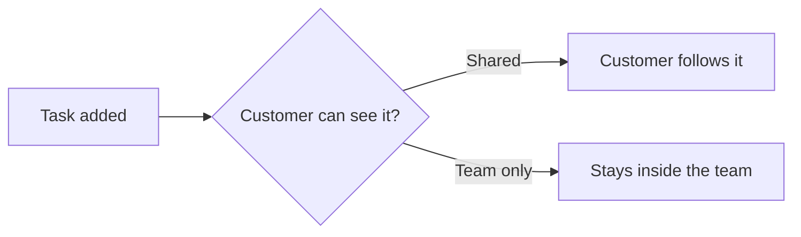

The task description editor has one kind of block for all three: the **code block**. What it does depends on its
**language**. A normal language gets syntax highlighting; the languages `chart` and `mermaid` are drawn as a picture.

## Add a code block

Use **Code block** in the toolbar's **Text style** menu, in the **+** menu, or in the slash menu (type `/`). You can
also paste code from VS Code, which lands as a code block in the language VS Code reports (see
[Write in the editor](/help/basics/the-editor)).

Each block has a header with a **language picker** at its right. Click it, search for a language and pick it, or leave it
on **Auto-detect** and the editor guesses. The picker offers: Bash, C, C++, C#, CSS, Dockerfile, Go, GraphQL, HTML,
HTTP, Java, JavaScript, JSON, Kotlin, Lua, Makefile, Markdown, PHP, Python, R, Ruby, Rust, Scala, SCSS, Shell, SQL,
Swift, TypeScript and YAML, plus **Chart** and **Mermaid diagram**. A picked language is the reliable way to get the right
colours; a guess can be wrong, especially for short snippets.

Pasting into a code block puts the text in exactly as it is; nothing is turned into formatting.

## Charts

A chart is a code block whose language is **Chart**. You write a few lines and the editor draws the chart under them.
Choose **Chart** from the **+** menu or slash menu and you get a small example to change:

```text
type: bar
title: Monthly revenue
labels: Jan, Feb, Mar, Apr
Revenue: 12, 19, 14, 22
Costs: 8, 9, 10, 11
```

- `type:` is `bar` (the default), `line` or `pie`.
- `title:` is optional.
- `labels:` names the points along the bottom (or the slices of a pie). Without it the points are numbered 1, 2, 3.
- Every other line is a **series**: a name, a colon and its numbers, separated by commas.
- A line starting with `#` or `//` is a comment and is ignored.
- A pie takes one number per slice, either as `Name: value` lines, or as one series plus `labels`. A pie cannot show a
  negative number.
- A chart shows up to eight series; more than that are folded into one called *Other*.

If a line is wrong, the chart keeps its last good drawing and the reason is shown under it, for example
*"Sales" has no values* or *Unknown chart type*.

## Mermaid diagrams

A **Mermaid diagram** block holds text in the [Mermaid](https://mermaid.js.org) language, which draws flowcharts, sequence
diagrams, Gantt charts, state diagrams, pie charts and more. The new block starts with a small flowchart:

```text
flowchart LR
  A[Idea] --> B{Worth it?}
  B -- Yes --> C[Build]
  B -- No --> D[Park it]
```

The diagram redraws a moment after you stop typing. While the text is mid-edit and not valid, the last good drawing
stays and the error is shown under it. Diagrams use the app's colours in both the light and the dark theme, and are
drawn in a strict mode that strips HTML labels and click handlers, so a diagram cannot run anything.

## Editing a drawn block

A chart or diagram shows as the **picture** when you are not in it. Click the picture, or hover and click **Edit**,
and the source opens above it with the cursor at its end. Click **Done**, or move out of the block, to fold the source
away again. The block's header also has the language picker, in case you want to turn a chart back into plain code.

## Who sees them

Everyone who reads the description sees the drawing: your team, a customer's contact when the task is shared, and the
public page of a shared board. A read-only reader never sees the source, only the picture. Because the source is
ordinary text in a code block, an agent can write a chart or diagram too, and they survive copying as Markdown.

## A drawn example

Here is a chart, as it would look in a description:

```chart
type: bar
title: Open tasks per week
labels: W1, W2, W3, W4
Opened: 9, 14, 6, 4
Closed: 5, 11, 10, 9
```

And a diagram:


