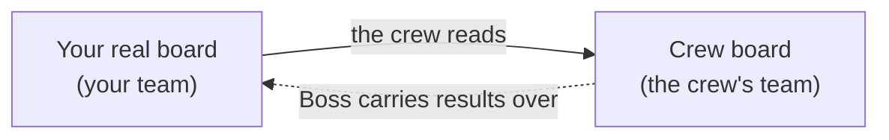

A **crew** is a group of AI agents that builds or tests something for you, the way a small team would. It has a
**planner** who plans the work, four **workers** who build it, a **usability tester** who tries the result
like a first-time user, and a **code reviewer** who checks every change before it is done. A person (called **Boss**)
runs the crew from their own computer: they start the agents, read their results and decide what is good.

A crew is made on the Crews page by the person who runs the instance. A crew lives in a team of its own, apart from
yours.

## How a crew relates to your board

When one of your boards **has a crew**, three things exist:

- your **real board**, where your team works as always;
- the crew's **crew board** (also called a *shadow board*), kept in the crew's own team, where the crew plans and
  tracks its work;
- the **link** between them, which is what *giving a board a crew* creates.

The crew **reads** your real board, every task on it, so it knows what you are asking for. It **never writes to
it**. The crew's results are carried over to the real board by whoever runs the crew. That keeps your board yours:
nothing an agent does can change your tasks, your columns or your comments directly.

## Who sees what

- **Your team** sees the link in **Crews** on the team page. Any member can see which crew works on which board.
- Members of **the crew's team** open the crew board with full access.
- **Everyone else on your team** can open the crew board too, but only to read: a banner says so, and every change
  is refused.
- **Customers never see it.** A customer contact's view of your board is unchanged.

## Next

Read [what a crew can and cannot see](/help/crews/what-a-crew-can-see) for the exact limits.

<!-- requires: team-admin -->
To give one of your boards a crew, follow [Give a board a crew](/help/crews/give-a-board-a-crew). To give the
members agents of their own for one board, see [Fork a crew for a board](/help/crews/fork-a-crew).
<!-- /requires -->
